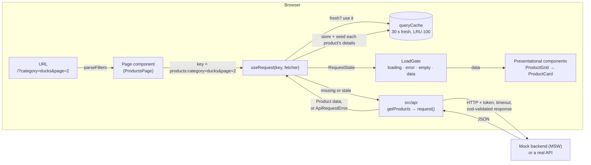
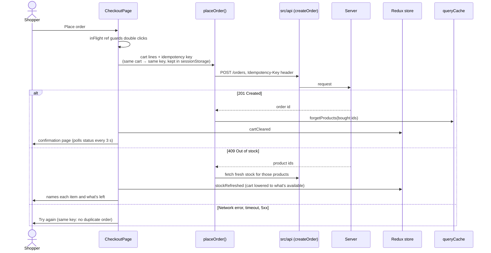
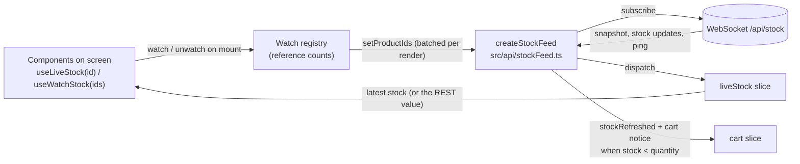

# Architecture

This page describes how the Bug Bazaar is put together: how the code is organized, how data moves from the API to the screen and back, and where each kind of state lives. It's written for an engineer joining the project who wants to find their way around before changing anything. Every file and name below exists in the code; the reasoning behind each choice is in [decisions.md](decisions.md), by task.

**In one paragraph:** a React 18 single-page app in TypeScript, built with Vite.

- **Server data** comes through one data layer (`src/api/`) and is cached by `useRequest` and a small query cache.
- **State the app owns** lives in Redux Toolkit: the cart, the session and live stock.
- **What the product list shows** lives in the URL.
- **The backend** is a mock that runs in the browser (MSW), implementing the shared API contract ([api-contract.md](api-contract.md)): REST for products, auth and orders, and a WebSocket for live stock. Pointing `VITE_API_BASE_URL` at a real server needs no code changes.

## Folder structure

```text
bug-bazaar/
├── src/
│   ├── main.tsx           Startup: monitoring, store, API wiring, live stock, mock, render
│   ├── app/               The shell: header, routes, error fallbacks, Not Found
│   ├── features/          One folder per feature, each with its pages, components and logic
│   │   ├── products/      List (pages and the virtualized all view), filters ⇄ URL, details, catalog cache rules
│   │   ├── cart/          cartSlice (the cart's rules), saved to localStorage, cart page, stepper, Add to cart
│   │   ├── auth/          sessionSlice, sessionStorage + startup check, login, RequireAuth, safe returnTo
│   │   ├── orders/        placeOrder (checkout as one operation), idempotency keys, checkout, confirmation
│   │   └── stock/         Live stock: slice, feed → store wiring, the watch registry, status indicator
│   ├── api/               The data layer: the only code that talks to the network
│   ├── cache/             queryCache: a keyed, time-stamped, size-limited cache
│   ├── hooks/             Shared hooks: useRequest, useDebouncedCallback, focus and title helpers
│   ├── components/        Shared UI: LoadGate, state cards, ErrorBoundary, icons
│   ├── errors/            classifyError (any error → AppError) and the one table of error copy
│   ├── monitoring/        Error reports, global error handlers, the bazaarMonitoring console
│   ├── store/             makeStore, typed hooks, connectApiToStore
│   ├── types/             API types (api.ts) and the RequestState union (request.ts)
│   ├── utils/             formatPrice (cents → "$19.99"), toError
│   ├── mocks/             The mock backend: MSW handlers, an in-memory DB, the stock feed server, QA controls
│   ├── dev/               QA tools: the QA panel, the crash test
│   ├── test/              Test setup, TestApp (the real App + a fresh store), shared queries
│   └── styles/global.css  One stylesheet, mobile first
├── scripts/               Lighthouse, performance and scroll measurements, the Vitest launcher
├── public/                Product images, the MSW Service Worker
└── docs/                  This page, decisions, and the per-topic write-ups
```

Tests sit next to the code they test (`cartSlice.test.ts` beside `cartSlice.ts`). Tests that cross features have their own folders: `src/journeys/` (the purchase journey), `src/a11y/` (axe checks) and `src/errors/errorMatrix.test.tsx`.

### The rules between folders

These rules are enforced by ESLint, not just written down, so they hold without anyone remembering them.

| Rule                                                                                                      | Enforced by                                                               |
| --------------------------------------------------------------------------------------------------------- | ------------------------------------------------------------------------- |
| Only `src/api/` makes network calls (`fetch`, `WebSocket`, …); the mock and `main.tsx` are the exceptions | `no-restricted-globals`                                                   |
| Everything else imports the data layer only from `src/api/index.ts`, never its internal files             | `no-restricted-imports`                                                   |
| UI code never imports the mock backend                                                                    | `no-restricted-imports`                                                   |
| UI code never reads an error's `.message`; it classifies the error and shows our own copy                 | `no-restricted-syntax` in `app`, `components`, `features`, `hooks`, `dev` |

**Imports go in one direction:** `app` → `features` → shared folders (`components`, `hooks`, `api`, `cache`, `errors`, `store`, `types`, `utils`). There are two exceptions, both deliberate:

- `store/` imports the slices from `features/`, because it builds the store from them.
- `components/states.tsx` uses `loginHref` from `features/auth/`, so every error state's **Sign in** link returns the user to the same page. If more shared code needed auth helpers, `returnTo.ts` would move to a shared folder.

Features don't import each other's pages. They share in three ways:

- **Through the store:** for example, live stock lowers a cart line by dispatching the cart's `stockRefreshed` action.
- **Through small components:** `stock/`'s `LiveStockStatus` and `StockNotices` appear on product, cart and checkout pages.
- **Through a few plain functions:** for example, `orders/` calls `forgetProducts` from `products/`.

The data layer never imports the store either. `connectApiToStore` passes it two functions at startup, one to read the token and one to end the session on a 401. That keeps the API layer testable on its own, with no import cycle.

## How data flows

### Loading and showing data (REST)



1. **The URL decides what to show.** `parseFilters` turns the query string into validated filters. Anything invalid falls back to its default, because anyone can edit a URL.
2. **The page asks `useRequest`** with a key built from those filters.
   - When the key changes, the previous request is aborted and the state resets at once, so old results never flash (race conditions, D2-6).
   - Cached data younger than 30 s is used without a request. Older data is shown at once and refreshed in the background (D3-5).
3. **The data layer** (`request()` in [src/api/client.ts](../src/api/client.ts)) does the HTTP work in one place:
   - builds the URL and adds the token
   - applies a 10 s timeout and the caller's AbortSignal
   - validates the response against the contract with zod
   - turns every failure into one error type, `ApiRequestError`
4. **`LoadGate`** maps the request state to loading, error, empty, not found or success. Each page shows those states the same way.
   - On an error, `classifyError` decides what it means: offline, timeout, server, not found and so on.
   - `describeLoadError` picks the copy, and whether **Try again** is offered.
5. **Presentational components** render the data. `ProductCard` is memoized and takes only primitive props, so updating one card doesn't re-render the other 23.

### Changing data: checkout



### Live stock (WebSocket)



- **Watching:** components register the products they show and unregister when they unmount. With nothing on screen, there's no subscription and no connection.
- **Recovering:** the feed reconnects with backoff and jitter, and re-subscribes after reconnecting. It treats 25 s of silence as a dead connection.
- **Lifecycle:** the feed reacts to the browser going online or offline and to tab visibility, and closes when the page is hidden for good.
- **The cart:** a cart line whose stock drops below its quantity is lowered, with a notice. It's the same rule as a 409 at checkout.

### Startup

[src/main.tsx](../src/main.tsx) runs in this order:

1. Install the global error handlers, so even startup errors are logged.
2. Load the saved cart (localStorage) and session (sessionStorage), validated, as the store's starting state. Every later change is saved again.
3. Connect the API client to the store (token and 401 handling).
4. Create the live stock feed. It stays idle until something watches a product.
5. Start the mock backend, then render.
6. Check a restored session with `GET /me`: an expired token ends the session.

## Where state lives

There are three kinds, and each has one home. The test for each is who needs it, and what should happen on a reload or a shared link.

### Server state: a copy of what the backend knows

| What                                 | Where                                            | Lifetime                                                    |
| ------------------------------------ | ------------------------------------------------ | ----------------------------------------------------------- |
| Product lists and details            | `queryCache`, through `useRequest`               | Fresh 30 s, then stale-while-revalidate; up to 100 entries  |
| Related products                     | `queryCache`                                     | Fresh 5 min                                                 |
| Pages of the all view                | `VirtualProductGrid` component state             | While the view is open (it also reads and writes the cache) |
| The signed-in user (`/me`), an order | `useRequest` without a cache, or component state | Always fetched fresh: these must be current                 |
| Live stock numbers                   | Redux `liveStock` slice                          | While watched; the REST value is the fallback               |

- **Invalidation:** after an order or a 409, `forgetProducts` drops every cached entry that shows those products, so the next visit shows real stock.
- **Lists seed details:** each listed product is cached under its details key, so opening a product from the list is instant.

### Client state: owned by the app

| What                                                                        | Where                                      | Why there                                                                               |
| --------------------------------------------------------------------------- | ------------------------------------------ | --------------------------------------------------------------------------------------- |
| Cart lines                                                                  | Redux `cart` slice → **localStorage**      | The header badge, details page and cart page share it; it survives a reload             |
| Session (token + user)                                                      | Redux `session` slice → **sessionStorage** | Read by the API client, header and route guards; ends with the tab ([auth.md](auth.md)) |
| Live stock feed status and cart notices                                     | Redux `liveStock` slice                    | The header shows the status; the cart and checkout pages show the notices               |
| Checkout idempotency key                                                    | **sessionStorage**, keyed by cart contents | Must survive a reload mid-checkout, so a retry can't double-charge                      |
| All view scroll position                                                    | **sessionStorage**, keyed by the query     | Back from a product returns to the same row                                             |
| Form drafts, checkout progress, "Added" messages, the stepper's typed value | Component state (`useState`, refs)         | Nobody else needs them                                                                  |

**Redux holds only what distant parts of the app share and change.** Derived values such as the cart count and total are never stored: `createSelector` computes them from the lines, so they can't drift. The cart's rules live in its reducer: quantities are clamped to stock, adding merges lines, and 0 removes a line. The UI can't create an invalid cart.

### URL state: what a link should reproduce

| What                                         | Where                           | Example                                 |
| -------------------------------------------- | ------------------------------- | --------------------------------------- |
| Which page                                   | The path                        | `/products/p-0042`, `/orders/o-00017`   |
| Search, category, in stock, sort, page, view | The query string (`filters.ts`) | `/?search=duck&category=ducks&page=2`   |
| Where to go back to after signing in         | `?returnTo=` (local paths only) | `/login?returnTo=%2Fcheckout`           |
| Which list a product was opened from         | Router state, not the URL       | Keeps `/products/p-0042` clean to share |

The query string has one canonical form: defaults are left out, so the same view always gets the same URL. That string is also the cache key, so "same URL" means "same cached data".

## A choice to defend: server data is not in Redux

The app already uses Redux. Putting products in it as well, with thunks, `status` fields and a `products` slice, would be the obvious move. I didn't.

- **It's a copy, not app state.** The server owns products. What the client needs to manage is how old its copy is, when to refetch, and when to throw it away. Redux has no idea of any of that. A products slice would need hand-written staleness, cancellation, per-query storage and eviction: a cache written badly inside a store. `useRequest` + `queryCache` does exactly that job, in under 200 lines, with tests.
- **It keeps the problems that matter testable on their own.** Race conditions (aborting on key change), stale-while-revalidate and cache invalidation are each one function with its own tests, instead of being spread across action types and reducers.
- **Redux stays small and meaningful.** Three slices, each with real rules: the cart's limits, the session's states, live stock. Opening Redux DevTools shows what the _user_ did, not 40 request lifecycles.
- **The cost:** two places to look for data, and `forgetProducts` has to know what each cached shape looks like (a list, a product, related products). That's acceptable for three shapes. With many more, or with mutations that update several queries, I'd move to **RTK Query** or TanStack Query, which do the same thing with tag-based invalidation. `useRequest`'s keys were designed to map one-to-one onto their query keys, so that move is mechanical.

## Where to look

| To change…                                | Start in                                                                          |
| ----------------------------------------- | --------------------------------------------------------------------------------- |
| An endpoint, or how errors are parsed     | [src/api/](../src/api/), then [api-contract.md](api-contract.md)                  |
| What an error says to the user            | [src/errors/describeError.ts](../src/errors/describeError.ts)                     |
| Cache times, or what an order invalidates | [src/features/products/catalogCache.ts](../src/features/products/catalogCache.ts) |
| Cart rules                                | [src/features/cart/cartSlice.ts](../src/features/cart/cartSlice.ts)               |
| A filter, or the URL format               | [src/features/products/filters.ts](../src/features/products/filters.ts)           |
| The mock's data or behavior               | [src/mocks/](../src/mocks/); QA controls in the QA panel                          |
| How errors are logged                     | [src/monitoring/](../src/monitoring/), then [monitoring.md](monitoring.md)        |
