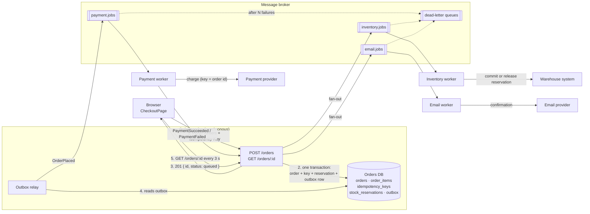

# Orders: the order flow behind `POST /orders`

This page designs the backend that would sit behind the store's checkout: an **order service** that accepts the order and places jobs on a **queue** for **payment**, **inventory** and **email** workers (D5-3). It's for engineers building or reviewing that backend, and for frontend engineers who want to know what "queued" means.

**Today**, the mock backend does all of this in one function ([src/mocks/db.ts](../src/mocks/db.ts) `placeOrder`), and the status timeline (`queued → processing → completed`) is simulated on a timer. The design below keeps **the same API contract** ([api-contract.md](api-contract.md)), so the frontend doesn't change when it's built.

## The flow

### Step by step

1. **The browser sends the order** with an `Idempotency-Key` header. It's one key per checkout attempt; [Preventing double charges](#preventing-double-charges) explains how it's chosen.
2. **The order service does the part that must be synchronous, in one database transaction:**
   - **Check the key.** If `(user_id, idempotency_key)` already exists, return the original order (`201`, same `id`). Nothing else happens.
   - **Reserve stock.** For each line, a conditional update: `UPDATE stock SET reserved = reserved + :qty WHERE product_id = :id AND available - reserved >= :qty`. If any line fails, roll back and return **409** naming every short item. That's the D3-2 contract, and it's why this step can't wait for a worker: the shopper needs the answer now.
   - **Write the order** (`status = queued`), the **key**, and an **outbox row**, `OrderPlaced { orderId }`.
   - **Commit.** It's all or nothing: there's never an order without a reservation, or a reservation without an order.
3. **Respond `201 { id, status: "queued" }`.** That takes milliseconds, whatever the payment provider is doing.
4. **The outbox relay** reads new outbox rows and publishes them to the broker. It marks them sent only after the broker acknowledges.
   - This is the _transactional outbox_ pattern. Publishing directly from the request handler could commit the order and then crash before publishing, leaving an order nobody processes. Or it could publish and then fail to commit, leaving a job for an order that doesn't exist.
5. **The workers run, and the order service records progress:**

   | Event                                            | Order status        | Then                                                                                        |
   | ------------------------------------------------ | ------------------- | ------------------------------------------------------------------------------------------- |
   | `OrderPlaced`                                    | `queued`            | payment job                                                                                 |
   | Payment worker picks it up                       | `processing`        |                                                                                             |
   | `PaymentSucceeded`                               | `processing`        | inventory job (_commit_ the reservation, notify the warehouse) and email job (confirmation) |
   | `InventoryCommitted`                             | **`completed`**     |                                                                                             |
   | `PaymentFailed` (declined, or retries exhausted) | `payment_failed` \* | inventory job (_release_ the reservation), and an email job ("payment didn't go through")   |

   \* **Contract change needed:** today's contract has only `queued`, `processing` and `completed`, because the mock never fails a payment. A real flow needs a terminal failure status. Adding `payment_failed` is an additive change. The confirmation page would need one more step state, "Payment didn't go through", with a link back to the cart. The cart has already been cleared by then, so the order's items would be offered back.

6. **The browser polls** `GET /orders/:id` every 3 s ([OrderConfirmationPage](../src/features/orders/pages/OrderConfirmationPage.tsx)) and stops at `completed`. The page shows the status from the order service, never from email.

**Email is not on the path to `completed`.** An order is complete when it's paid for and the stock is committed. Whether the confirmation email arrived is tracked separately.

## Why a queue helps

- **Fast, predictable checkout.** The shopper waits for one database transaction, not for a payment provider (often 1–3 s, sometimes far more), a warehouse API and an email provider in a row. A slow third party doesn't make checkout slow.
- **A failure in one part doesn't fail the order.** If email is down, orders keep going through (next section). If the payment provider has an outage, orders are accepted and charged when it's back, instead of every checkout failing.
- **Retries are built in.** A job that fails goes back on the queue and is retried with backoff. Without a queue, every caller would need its own retry loop, and a crashed server would forget what it was retrying.
- **Absorbs spikes.** A flash sale doubles orders for ten minutes. The order service only does short transactions, and the queue holds the backlog while workers catch up at their own pace.
- **Each part scales on its own.** Payment workers can be scaled out (horizontal scaling) without touching email. Each worker type can also be deployed, paused or rolled back separately.

**The costs:**

- **Eventual consistency:** right after checkout, the order says `queued`, not "paid". The confirmation page is built for that, with steps that fill in as the status moves.
- **More moving parts to run:** a broker, dead-letter queues and their alerts.
- **At-least-once delivery:** a job can arrive twice, so every worker must be idempotent (next sections).

## What happens if email is down

1. **Checkout is unaffected.** Email isn't called during `POST /orders`. The order is placed, paid and completed as usual, and the confirmation page shows it.
2. **The email worker's sends fail,** so the job isn't acknowledged. The broker redelivers it with **exponential backoff**: after 1 min, 5 min, 30 min, 2 h, and so on.
3. **Nothing is lost while it's down.** Jobs wait in `email.jobs`. When the provider is back, the backlog drains on its own, oldest first, and late confirmations go out.
4. **After about 24 hours of failures,** the job moves to the **dead-letter queue** and an alert fires. Someone fixes the cause (a bad template, an expired API key) and replays the dead-letter queue into `email.jobs`.
5. **No double emails on retry.** Before sending, the worker records `(order_id, "confirmation")` in a `sent_emails` table with a unique constraint, and passes the same value as the provider's idempotency or deduplication key. That's best effort: some providers don't offer one. A redelivered job finds the row and stops.
6. **What the shopper sees:** their order and its status on the confirmation page (a real store would also list it in an order history; this one has none yet). An email that arrives an hour late is an annoyance. An order that failed because email was down would be a lost sale.

**Worth tracking** ([monitoring.md](monitoring.md)): the depth and oldest-message age of `email.jobs`. A growing queue is the first sign of an outage, before anyone complains.

## Preventing double charges

A double charge needs the same purchase to be charged twice. That can happen in three places, and each layer stops it, so no single layer has to be perfect.

### 1. In the browser: one key per checkout attempt (D3-2, built)

- **The key:** [checkoutKey.ts](../src/features/orders/checkoutKey.ts) creates one key per **cart signature**, an order-independent fingerprint of the cart such as `p-0001x2,p-0042x1`. It's kept in `sessionStorage`.
- **What reuses the key:** a retry after a timeout or a 500, a double click, and even a page reload mid-checkout all send the **same key**.
- **What gets a new one:** a different cart is a different purchase, so it gets a new key. The key is cleared after a successful order, so buying the same items again later is a new order.
- **Double clicks:** [CheckoutPage](../src/features/orders/pages/CheckoutPage.tsx) also guards with an `inFlight` ref, so a second click while the first request is out doesn't send anything.
- **Why this matters most:** the dangerous case is a **lost response**. The order went through, but the reply never arrived, so the shopper sees "Try again". Retrying with the same key gets back the order that already exists.

### 2. In the order service: the key is unique

- **The key is stored in the same transaction as the order,** under a unique constraint on `(user_id, idempotency_key)`. A retry finds it and returns the original order. It doesn't reserve stock again, write another outbox row, or create another payment job.
- **Concurrent duplicates:** two copies of the request can arrive at the same moment, for example from two tabs. Both try to insert the key. The database lets one succeed, and the other gets a unique-violation error and returns the winner's order.
- **The same key with a different cart** should be rejected with `422`: it means a client bug, not a retry. A fingerprint of the request body would be stored with the key. The mock doesn't check this today. The browser can't trigger it, because the key is derived from the cart, but a real server must not trust that.

### 3. In the payment worker: charge each order once

The broker delivers **at least once**. A worker can charge the card and then crash before acknowledging the job, and the job is redelivered.

- **A local payment record per order,** moved forward with conditional updates: `pending → charging → captured`. A worker that finds `captured` acknowledges and stops.
- **The provider's own idempotency:** the charge is sent with `Idempotency-Key: order-<orderId>`. If the worker crashed _after_ the provider charged but _before_ recording it, the retry sends the same key, and the provider returns the original charge instead of charging again. Payment providers such as Stripe support this.

Together:

- **A lost response** is handled by layer 1 plus layer 2.
- **Two tabs or a double submit** are handled by layer 1 (the ref), plus layer 2's unique constraint.
- **A redelivered payment job** is handled by layer 3.

At every step, a repeat of the same purchase reuses the same key.

## Other failures, briefly

| Failure                                             | What happens                                                                                                                                                                           |
| --------------------------------------------------- | -------------------------------------------------------------------------------------------------------------------------------------------------------------------------------------- |
| Order service crashes after commit, before replying | The browser times out and shows Try again. The retry has the same key and gets the original order.                                                                                     |
| The broker is down                                  | Orders are still accepted: outbox rows pile up in the database, and the relay publishes them when the broker is back.                                                                  |
| A worker crashes mid-job                            | The job isn't acknowledged, so it's redelivered once its visibility timeout runs out. Workers are idempotent, so running it again is safe.                                             |
| Payment provider down                               | Payment jobs are retried with backoff and the order stays `processing`. If the outage outlasts the retry budget, the order is set to `payment_failed` and the reservation is released. |
| Reservations that never resolve                     | A sweeper releases reservations of orders stuck in `queued` past a deadline, so stock isn't locked forever by a bug.                                                                   |
| A poison message (a job that always fails)          | After N attempts it moves to the dead-letter queue with its error, and the queue behind it keeps moving.                                                                               |

## How this maps to the frontend today

| Concern                           | In the browser now                            | In this design                                                                      |
| --------------------------------- | --------------------------------------------- | ----------------------------------------------------------------------------------- |
| Idempotency key                   | `checkoutKey.ts`, sent as `Idempotency-Key`   | Unique `(user_id, key)` in the orders DB                                            |
| Stock check, 409                  | The mock checks and reserves in one step      | A conditional reservation in the order transaction                                  |
| `queued → processing → completed` | The mock fakes it on a timer (0–5 s, 5–15 s)  | Driven by worker events                                                             |
| Status updates                    | Polling every 3 s                             | The same polling. Server-sent events or the existing WebSocket could push it later. |
| Live stock after an order         | The mock emits stock changes on the WebSocket | The inventory service publishes `StockChanged` to the feed                          |
